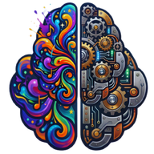
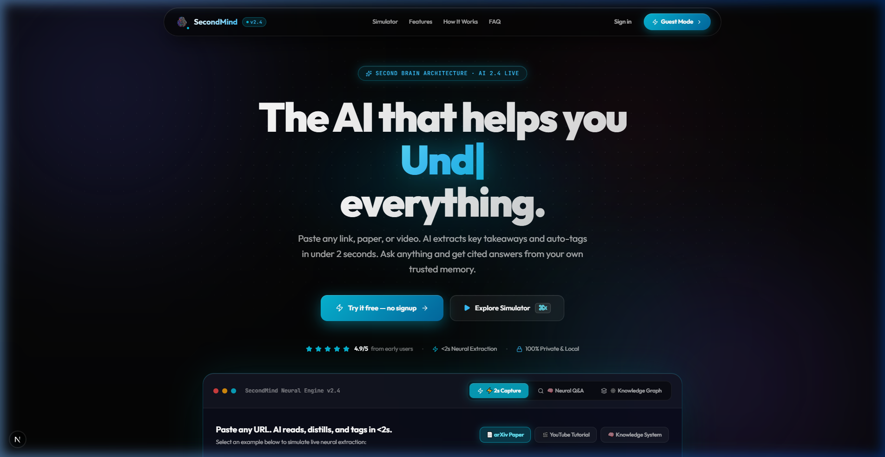
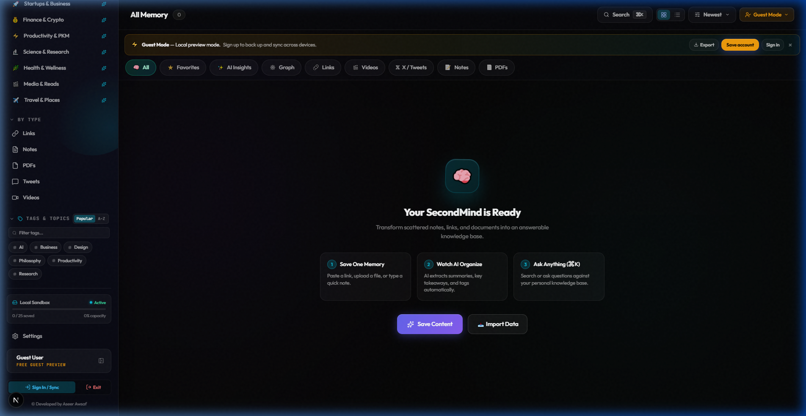
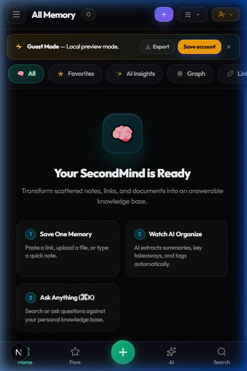
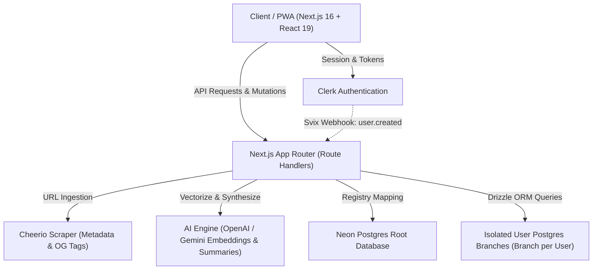

<div align="center">

  

  # SecondMind

  **The AI-Powered Second Brain & Intelligent Memory Hub**

  *Capture anything in under two seconds. Organize effortlessly with AI. Retrieve intuitively with semantic vector search and interactive knowledge graphs.*

  <p align="center">
    <a href="#key-features">Key Features</a> •
    <a href="#screenshots--interface">Screenshots</a> •
    <a href="#architecture">Architecture</a> •
    <a href="#database--isolation">Data Isolation</a> •
    <a href="#quick-start">Quick Start</a> •
    <a href="#environment-variables">Environment Setup</a> •
    <a href="ROADMAP.md">Roadmap</a>
  </p>

  <p align="center">
    
    
    
    
    
    
    
  </p>

</div>

---

## 🌟 Overview

**SecondMind** is a next-generation personal knowledge base and memory assistant engineered for researchers, engineers, and creators. In a world inundated with bookmarked links, fragmented browser tabs, Discord messages, and ephemeral thoughts, SecondMind acts as an externalized cognitive engine.

Simply paste a URL, write a markdown thought, upload a document, or capture media—SecondMind immediately scrapes rich metadata, synthesizes key insights, generates multi-dimensional tags, generates 1536-dimensional vector embeddings, and links the item into your personal knowledge graph.

<div align="center">
  
</div>

---

## 📸 Screenshots & Interface

### 🖥️ Desktop Command Center
A unified, cyber-glass dashboard featuring real-time telemetry, tag filtering, AI recall widgets, and bento-grid memory cards.

<div align="center">
  
</div>

---

### 📱 Mobile Experience (PWA)
Engineered for frictionless on-the-go thought capture. Full responsive mobile interface with floating action buttons, instant search, and native offline caching.

<div align="center">
  
</div>

---

## 🚀 Key Features

### ⚡ 1. Rapid Ingestion (< 2 Seconds)
- **Universal Capture:** Save URLs, raw thoughts, technical code snippets, tweets/threads, YouTube videos, PDFs, and screenshots.
- **Automated Web Scraping:** Integrated server-side scraper powered by `cheerio` extracts open-graph imagery, canonical titles, author metadata, and readable content automatically.
- **Smart Formatting:** Automatic code syntax highlighting, markdown rendering, and thumbnail caching.

### 🧠 2. AI Synthesis & Vector Embeddings
- **Automated Summaries:** LLM-powered extraction distills lengthy essays, documentation, and videos into digestible bullet points.
- **Zero-Manual Tagging:** Generates semantic, domain-aware tags and categorization tags automatically.
- **Vector Search (1536-dim):** Embeddings stored natively in Postgres vector columns enable natural language semantic retrieval (*"what was that article about distributed vector indexes?"*).

### 🕸️ 3. 2D Interactive Knowledge Graph
- Powered by `react-force-graph-2d`.
- Visualizes the emergent clustering between your tags, memories, domains, and collections.
- Interactive node physics with real-time zooming, panning, and contextual selection.

### 🛡️ 4. Isolated Per-User Neon Database Branching
- **Unrivaled Multi-Tenant Privacy:** Rather than relying solely on shared tables with row-level filtering, SecondMind integrates **Neon Serverless Branching**.
- When a user signs up via Clerk, a webhook triggers programmatic creation of an isolated Postgres branch dedicated exclusively to that user.
- Root branch houses only user registration mappings, while personal data lives within isolated per-user branches.

### 📁 5. Smart Collections & Bidirectional Linking
- Group memories into custom projects, research folders, or reading lists.
- Smart collections with automated rule-based filters.
- Roam/Obsidian-style `[[link]]` bidirectional references between thoughts.

### 📴 6. Progressive Web App (PWA) & Guest Mode
- Service worker implementation powered by `@serwist/next` for seamless offline access.
- **Guest Mode:** Experience full local capture and storage directly in IndexedDB/LocalStorage before signing up.

---

## 🏗️ System Architecture



---

## 🗄️ Database Schema & Data Isolation

Managed via **Drizzle ORM** with native `pgvector` support:

```typescript
// 1. Root Branch: User Branch Directory
export const userBranches = pgTable('user_branches', {
  userId: text('user_id').primaryKey(),
  email: text('email').notNull(),
  branchId: text('branch_id').notNull(),
  connectionUrl: text('connection_url').notNull(),
  createdAt: timestamp('created_at', { withTimezone: true }).defaultNow().notNull(),
});

// 2. User Isolated Branch: Memory Items & Vector Embeddings
export const memoryItems = pgTable('memory_items', {
  id: uuid('id').defaultRandom().primaryKey(),
  userId: text('user_id').notNull(),
  type: text('type').notNull(), // 'link' | 'note' | 'image' | 'pdf' | 'tweet' | 'video'
  title: text('title').notNull(),
  content: text('content').notNull(),
  url: text('url'),
  sourceDomain: text('source_domain'),
  thumbnailUrl: text('thumbnail_url'),
  summary: text('summary').default(''),
  tags: jsonb('tags').$type<string[]>().default([]),
  isFavorite: boolean('is_favorite').default(false).notNull(),
  aiProcessed: boolean('ai_processed').default(false).notNull(),
  embedding: vector('embedding', { dimensions: 1536 }),
  createdAt: timestamp('created_at', { withTimezone: true }).defaultNow().notNull(),
});

// 3. User Isolated Branch: Collections & Relational Links
export const collections = pgTable('collections', { ... });
export const collectionItems = pgTable('collection_items', { ... });
```

---

## 🧰 Tech Stack

| Layer | Technologies |
| :--- | :--- |
| **Framework** | [Next.js 16 (Turbopack, App Router)](https://nextjs.org/) + [React 19](https://react.dev/) + [TypeScript](https://www.typescriptlang.org/) |
| **Styling & Motion** | [Tailwind CSS v4](https://tailwindcss.com/) + [Framer Motion](https://www.framer.com/motion/) + [GSAP](https://greensock.com/gsap/) |
| **Authentication** | [Clerk Auth](https://clerk.com/) (`@clerk/nextjs`, `@clerk/themes`) |
| **Database & ORM** | [Neon Serverless Postgres](https://neon.tech/) + [Drizzle ORM](https://orm.drizzle.team/) + `pgvector` |
| **AI & NLP** | [OpenAI API](https://openai.com/) (Embeddings: `text-embedding-3-small`, Summaries) + Gemini Studio |
| **Visualization** | [react-force-graph-2d](https://github.com/vasturiano/react-force-graph) + [OGL](https://github.com/oframe/ogl) |
| **PWA & Offline** | [Serwist](https://serwist.pages.dev/) (`@serwist/next`) |
| **Icons & UI** | [Lucide React](https://lucide.dev/) |

---

## ⚡ Quick Start

### Prerequisites
- Node.js `20.x` or higher
- npm, pnpm, or yarn
- A [Clerk](https://clerk.com/) account for auth
- A [Neon](https://neon.tech/) Postgres account with an API key
- An [OpenAI](https://platform.openai.com/) or [Google AI Studio](https://aistudio.google.com/) key

### 1. Clone & Install

```bash
git clone https://github.com/aseerawsaf45-dev/secondmind.git
cd secondmind
npm install
```

### 2. Environment Configuration

Copy `.env.example` to create your local `.env.local` configuration:

```bash
cp .env.example .env.local
```

Fill in the required keys in `.env.local` (see [Environment Variables](#-environment-variables) below).

### 3. Database Migration

Push schema to your Neon root branch:

```bash
npx drizzle-kit push
```

### 4. Run Development Server

```bash
npm run dev
```

Navigate to [http://localhost:3000](http://localhost:3000) in your browser.

---

## ⚙️ Environment Variables

| Variable | Scope | Required | Description |
| :--- | :--- | :---: | :--- |
| `NEXT_PUBLIC_CLERK_PUBLISHABLE_KEY` | Client / Browser | **Yes** | Clerk publishable API key |
| `CLERK_SECRET_KEY` | Server-Only | **Yes** | Clerk backend secret key |
| `NEXT_PUBLIC_CLERK_SIGN_IN_URL` | Client / Browser | **Yes** | Sign-in route path (`/login`) |
| `NEXT_PUBLIC_CLERK_SIGN_UP_URL` | Client / Browser | **Yes** | Sign-up route path (`/signup`) |
| `CLERK_WEBHOOK_SECRET` | Server-Only | **Yes** | Svix webhook secret to provision per-user branches on `user.created` |
| `DATABASE_URL` | Server-Only | **Yes** | Root Neon Postgres connection string with pooling |
| `NEON_API_KEY` | Server-Only | **Yes** | Neon management API token to provision user branches |
| `NEON_PROJECT_ID` | Server-Only | **Yes** | Neon project identifier |
| `OPENAI_API_KEY` | Server-Only | **Yes** | OpenAI API key for 1536-dim embeddings and synthesis |
| `GEMINI_API_KEY` | Server-Only | Optional | Alternative / supplementary AI studio model key |
| `NEXT_PUBLIC_SITE_URL` | Client / Browser | Optional | Canonical URL origin (default `http://localhost:3000`) |

---

## 🔒 Security Best Practices

> **CRITICAL SECURITY NOTE**:
> 1. In Next.js, only variables prefixed with `NEXT_PUBLIC_` are bundled into browser assets.
> 2. Database connection strings, `CLERK_SECRET_KEY`, `NEON_API_KEY`, and webhook secrets MUST remain strictly server-only.
> 3. Never commit `.env` or `.env.local` files to source control.
> 4. If deploying to staging or production, rotate your API keys and webhook signing secrets in their respective vendor consoles.

---

## 📂 Project Structure

```text
secondmind/
├── public/                 # Static assets, logos, and screenshots
│   ├── logo.png            # Dual-hemisphere logo emblem
│   ├── og-image.png        # Social share & overview hero comp
│   ├── screenshot-desktop.png  # Desktop command center screenshot
│   └── screenshot-mobile.png   # Mobile PWA mockup screenshot
├── src/
│   ├── app/                # Next.js 16 App Router pages & API routes
│   │   ├── api/            # Serverless endpoints (extract, webhooks/clerk, export)
│   │   ├── app/            # Main logged-in application dashboard
│   │   ├── guest/          # Guest mode local-storage route
│   │   ├── login/ & signup/# Clerk-backed authentication pages
│   │   ├── roadmap/        # Public roadmap & feature tracker
│   │   ├── templates/      # Knowledge packs & workflow templates
│   │   ├── layout.tsx      # Root application layout & font declarations
│   │   └── page.tsx        # High-conversion landing page
│   ├── components/         # Modular UI & interactive client components
│   │   ├── CaptureModal.tsx        # Fast-capture modal (⌘K)
│   │   ├── GraphView.tsx           # 2D interactive force-directed graph
│   │   ├── ItemDetailModal.tsx     # Full reading & annotation modal
│   │   ├── MagicBento.tsx          # Dynamic responsive bento grid
│   │   ├── MemoryCard.tsx          # Memory card with tags & status
│   │   ├── SearchOverlay.tsx       # Instant search & semantic filter
│   │   └── Sidebar.tsx             # Collapsible navigation rail
│   ├── db/                 # Drizzle ORM schema & client configuration
│   │   ├── index.ts        # Database connection pool
│   │   └── schema.ts       # Tables (user_branches, memory_items, collections)
│   └── lib/                # Core utilities, scrapers & AI pipeline
│       ├── ai-engine.ts    # OpenAI / Gemini embedding & summary engine
│       ├── neon-branch.ts  # Neon programmatic branch provisioning
│       └── twitter.ts, facebook.ts, youtube.ts # Specialized content parsers
├── drizzle.config.ts       # Drizzle Kit migration configuration
├── next.config.ts          # Turbopack & CSP headers
└── package.json            # Dependencies & build scripts
```

---

## 🛣️ Roadmap

Check out [ROADMAP.md](ROADMAP.md) for current feature milestones, including:
- [x] Onboarding flow & guided data import
- [x] Responsive PWA mobile experience with offline cache
- [x] Semantic vector similarity search
- [x] 2D Interactive Knowledge Graph
- [x] Dedicated per-user isolated Neon branches
- [ ] End-to-End Encryption (E2EE) for sensitive personal vaults

---

## 👨‍💻 Author & Acknowledgments

- **Developed by:** [Aseer Awsaf](https://github.com/aseerawsaf45-dev)
- Built with passion for seamless knowledge discovery and modern UI/UX engineering.

---

<div align="center">
  <sub>Built with Next.js 16, React 19, Neon, Drizzle ORM, and Clerk.</sub>
</div>
